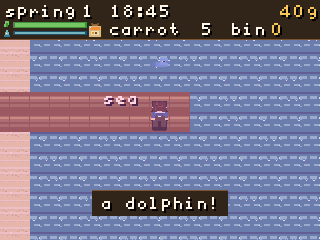

# RETRO Mini Farm

A cozy, child-friendly farming game for the **ELECFREAKS RETRO Arcade for Education** handheld.

It is written in **bare-metal C** for the STM32F412RE: no game engine, no JavaScript runtime, no web build. The firmware draws a 320×240 pixel-art world, runs the whole game loop, and saves to internal flash.

**This repository is source-only.** It does not commit the ARM toolchain, prebuilt UF2 files, simulator binaries or frame dumps. Build everything from source, or download the ready-to-flash UF2 from the GitHub **Releases** page.

<p align="center">
  
</p>

## What is it?

You inherit a small farm, grow crops through four seasons, make friends in town, fish at the beach, upgrade your house, adopt a cat or a chicken, and eventually unlock a little mine.

**Goal:** bring the town back to life. Finish all three storylines and become
3-heart friends with Mira, Tom and Lily before the end of year one. There is
no money finish line; coins are for upgrades, not for winning.

The game is designed to be readable by a young child:

- All in-game text is **lowercase**
- Short sentences, simple words
- 2× pixel font
- A / B / Menu controls only

## Features

### Farming

- **4 seasons × 28 days**
- **14 crops** with different prices, growth times and regrow crops
- Plant, water, harvest, ship produce, sleep and grow crops overnight
- Weather: sunny, rain, snow
- Energy, water can capacity, shipping bin, seed shop
- A year-one community ending (no money finish line)

### Town and relationships

- **3 NPCs**: Mira, Tom and Lily
- Daily schedules: home, town and shop
- **5 hearts** per NPC
- Gifts, favourites, portrait dialogue and weather/season lines
- **3 two-chapter storylines**
  - Mira: the empty seed shelf
  - Tom: the old pier
  - Lily: the flower crown
- Story journal page and NPC quest markers (`!` / `?`)

### Beach and fishing

- Sandy beach, water, pier and shells
- Buy a rod, cast, wait for the bite, then play a small green-bar fishing minigame
- 4 fish: sardine, bass, trout, tuna
- Fish go into the bag and can be shipped or gifted

### House and pets

- **5 house levels** with different exteriors and interiors
- Water can upgrades
- Buy **both** a cat and a chicken
- Feed them once a day; 2 feeds = 1 heart, with half-heart display
- Full hearts unlock daily gifts:
  - cat brings a fish
  - chicken lays an egg
- Both full hearts unlock a **small dinosaur** that digs ore every morning

### Mine

- Unlocked after all three storylines are complete
- Town mine entrance, rocks, copper ore, slimes and a sword
- Health, enemy contact damage, respawn at home
- Ore and story progress are saved

### Inventory and tools

- **30-slot bag** (6×5)
- Tools in the first row: hoe, watering can, rod, sword
- Items: seeds, crops, fish, egg and fossil
- Open the bag from **Menu → bag**
- **A select**, **B close**
- The bag reopens on the last selected item
- Harvesting does **not** change your selected item
- Seeds and produce have different names (`carrot seed` vs `carrot`)

### Art, audio and secrets

- Procedural pixel art, warm palette, portraits, animated water, dusk and weather
- A procedural **startup animation** (sky, sun, farmhouse, crops and pets) that
  releases no assets after it ends
- PWM sound effects on the Arcade speaker
- Save version 5 with migration from older saves
- **8 hidden moments**:
  - fountain wish
  - dolphin at the pier
  - cat sleeping on the bed
  - golden fish
  - dinosaur fossil
  - hidden NPC lines
  - campfire after all stories
  - a letter in the mailbox

## Download and install

The easiest way to play is the prebuilt UF2 from the
[latest GitHub release](../../releases/latest).

1. Hold **Menu + B** on the handheld until `ARCADE-F4` appears.
2. Copy `retro-mini-farm-v1.0.0.uf2` to the `ARCADE-F4` drive.
3. The device reboots automatically.

The release ZIP also contains the UF2, this README, the license and SHA-256
checksums. The save file is in a separate flash sector and is preserved by
normal firmware updates.

## AI / agent handoff

Another coding agent can pick this repository up without prior context:

- [AGENTS.md](AGENTS.md) — short operating rules and commands
- [docs/AI-HANDOFF.md](docs/AI-HANDOFF.md) — full environment, hardware,
  architecture, save format, modification recipes and acceptance checklist
- [docs/build-flash.md](docs/build-flash.md) — build and flash

Run the regression suite with:

```bash
cd native
make test
```

## Screenshots

All screenshots are rendered by the host simulator from the same `game.c` used by the firmware.

| | |
|---|---|
|  |  |
|  |  |
|  |  |
|  |  |
|  |  |
|  | |

## Controls

| Button | Action |
|---|---|
| D-pad | Move / move cursor |
| A | Use selected tool or item, talk to NPC, select in bag |
| B | Gift selected crop/fish near an NPC; close panels |
| Menu | Open the pause menu (bag, hearts, house, save, load, sleep) |
| Menu + B | Reboot into the UF2 bootloader |

### Bag

- Open with **Menu → bag**
- D-pad moves the cursor
- **A select**
- **B close**

### Fishing

- Select the rod in the bag
- Face water and press **A** to cast
- Press **A** when `!` appears
- Hold **A** to raise the green zone; release to lower it
- **B** cancels

## Build

### Requirements

- macOS or Linux
- `make`
- Python 3 (for UF2 and PNG tools)
- ARM GNU toolchain, for example xPack `arm-none-eabi-gcc`
- `libopencm3` is not committed. Fetch it with `make deps`; the Makefile
  clones the pinned `v0.8.0` tag and builds its `stm32f4` archive.

The Makefile expects the toolchain at:

```text
toolchain/xpack-arm-none-eabi-gcc-15.2.1-1.1/bin
```

You can point it somewhere else:

```bash
cd native
make TOOLCHAIN=/path/to/arm-none-eabi/bin
```

### Firmware

```bash
cd native
make deps      # clone pinned libopencm3 v0.8.0
make -j4
```

If `third_party/libopencm3` is missing, plain `make` will also fetch it
automatically.

Output:

```text
native/build/app.uf2
```

### Host simulator

The simulator uses the system C compiler and writes PNG frames:

```bash
cd native
make sim
```

Output is in `native/sim/out/` (not committed). The simulator is also how the README screenshots are generated.

### Regression tests

```bash
cd native
make test
```

This builds and runs the save/farm/menu/upgrade/season/beach/pets/story/mine/
easter-egg and year-end goal tests using the host compiler.

## Flash

1. Hold **Menu + B** until the device reboots into the bootloader.
2. A USB drive named `ARCADE-F4` appears.
3. Copy `native/build/app.uf2` to that drive.
4. The device reboots automatically.

On macOS:

```bash
cp native/build/app.uf2 /Volumes/ARCADE-F4/
```

Or:

```bash
cd native
make flash
```

The save lives in flash sector 7 and is separate from the application area, so normal firmware upgrades keep the farm.

## Hardware

| | |
|---|---|
| Device | ELECFREAKS RETRO Arcade for Education |
| MCU | STM32F412RE, Cortex-M4F |
| Clock | 96 MHz (with a safe 16 MHz fallback) |
| RAM | 256 KB |
| Flash | 512 KB (448 KB application area + 64 KB bootloader) |
| Display | ILI9341, 320×240, 8-bit parallel / FSMC |
| Save | Internal flash sector 7 (`0x08060000`) |
| Audio | PWM on PA08 + amplifier enable on PC10 |

## Project layout

```text
docs/                 design notes, build/flash guide, screenshots
firmware/             early hardware tests and historical backups
native/
  src/                game.c, main.c, save.c, font8.c
  sim/                host simulator and regression tests
  tools/              UF2 builder and framebuffer-to-PNG converter
  third_party/        vendored libopencm3
  Makefile
tools/                UF2 inspection helper
```

## Save compatibility

The current save format is **version 5**:

- farm, crops, coins, energy, water
- house / can / rod / story progress
- NPC hearts and gifts
- bag selection, fish, eggs, fossils
- pets, affection, dino, mine ore and health

Older v1–v4 saves are migrated automatically on load. A new save is written when you sleep, use Menu → save, upgrade, or complete a story quest.

## Known limitations

- Hoe is currently a tool placeholder; the field plots are already tilled.
- The mine currently has one floor.
- Tool upgrades beyond the water can are not implemented yet.
- The simulator is not cycle-accurate; real hardware frame rate may differ.
- Internal flash writes block the game briefly.

## Development

The game logic is in `native/src/game.c` and is shared by the firmware and the host simulator. The hardware layer is `native/src/main.c`:

- FSMC LCD setup and blit
- buttons
- clock/PLL
- PWM audio

`make sim` builds the simulator and runs the regression tours:

- save/load
- farming loop
- menu/bag
- house/can upgrades
- seasons
- beach/fishing
- pets/dino
- storylines
- mine
- easter eggs

## Credits

- Hardware: [ELECFREAKS](https://www.elecfreaks.com/)
- Low-level STM32 library: [libopencm3](https://github.com/libopencm3/libopencm3)
- Toolchain: [xPack ARM GNU Toolchain](https://xpack.github.io/arm-none-eabi-gcc/)
- Game code and procedural art: Keith Xi

## License

Original game code and art are released under the **MIT License**. See [LICENSE](LICENSE).

`libopencm3` remains under its own LGPL/GPL licenses; see `native/third_party/libopencm3/COPYING.*`.

---

中文说明：[README.zh-CN.md](README.zh-CN.md)
