# RETRO Mini Farm

在 **ELECFREAKS RETRO Arcade for Education** 掌机上运行的迷你农场游戏。

原生 C 固件，不依赖游戏引擎、网页运行时或 MakeCode；320×240 像素画，完整游戏循环，存档写在内部 Flash。

**仓库只包含源码**：不提交 ARM 工具链、预编译 UF2、模拟器二进制或帧转储。可以直接从源码构建，也可以到 GitHub **Releases** 下载已经打好的 UF2。

<p align="center">
  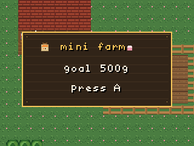
</p>

## 游戏内容

**目标**：让小镇重新热闹起来。在第一年结束前完成三条故事线，并且和 Mira、Tom、Lily 都达到 3 心。没有 500G 这种金钱终点；金币只用于升级。

- **4 季 × 28 天**
- **16 种作物**（每季 4 种）：用锄头翻土，再种植、浇水、收获、出货、睡觉生长
- 天气：晴、雨、雪
- 3 个 NPC：Mira、Tom、Lily
- **5 心**、送礼、喜好、头像对话、天气/季节台词
- **3 条双章节故事线**
  - Mira：空掉的种子架
  - Tom：旧栈桥
  - Lily：花冠
- 海滩、贝壳、鱼竿、钓鱼小游戏、4 种鱼
- **5 级房子**、水壶升级、鱼竿/剑升级
- 小猫 + 小鸡可以同时养；2 次喂食 = 1 心
- 猫满心每天带鱼；鸡满心每天下蛋；两只满心解锁小恐龙
- 三条故事完成后解锁两层矿洞：铜矿、史莱姆、剑、生命；梯子下第二层
- 鱼竿升级扩大钓鱼绿区；剑升级提高史莱姆伤害
- **30 格背包**、工具第一行、上次选中记忆
- 8 个隐藏彩蛋：许愿池、海豚、猫睡床、金色鱼、化石、NPC 隐藏台词、篝火、邮箱旧信
- 程序化启动动画（天空、太阳、农舍、作物、宠物），结束后不保留额外资源
- 存档 v6，旧版本自动迁移

## 操作

| 按键 | 作用 |
|---|---|
| 方向键 | 移动 / 移动光标 |
| A | 使用选中的工具或物品、和 NPC 说话、背包内选中 |
| B | 靠近 NPC 时送礼；关闭面板 |
| Menu | 菜单：背包、爱心、房子、存档、读档、睡觉 |
| Menu + B | 重启进入 UF2 烧录模式 |

### 背包

- 只能从 **Menu → bag** 打开
- 方向键移动
- **A 选中**
- **B 关闭**
- 会记住上次选中的物品
- 收获不会改变当前选中

### 钓鱼

- 背包里选鱼竿
- 面对水按 A 抛竿
- 出现 `!` 时按 A
- 按住 A 抬绿区，松开下降
- B 放弃

## 下载和安装

最方便的方式是下载 [最新 Release](../../releases/latest) 里的 UF2。

1. 按住 **Menu + B**，直到出现 `ARCADE-F4`
2. 把 `retro-mini-farm-v1.0.0.uf2` 拷进 `ARCADE-F4`
3. 设备自动重启

Release ZIP 里还包含 UF2、README、LICENSE 和 SHA-256 校验文件。存档在独立 Flash 扇区，正常升级不会丢。

## 给另一个 AI / 开发者的交接

- [AGENTS.md](AGENTS.md) — 短操作规则和命令
- [docs/AI-HANDOFF.md](docs/AI-HANDOFF.md) — 完整环境、硬件、架构、存档格式、修改配方和验收清单
- [docs/build-flash.md](docs/build-flash.md) — 编译和烧录

回归测试：

```bash
cd native
make test
```

## 截图

| | |
|---|---|
| 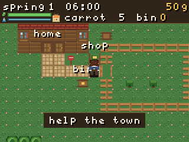 | 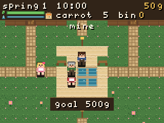 |
| 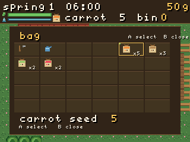 | 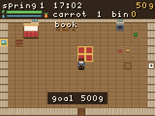 |
| 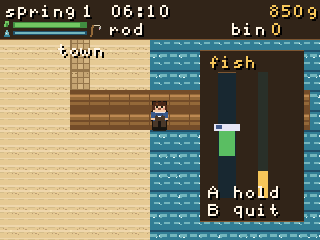 | 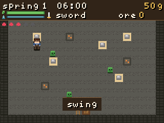 |
| 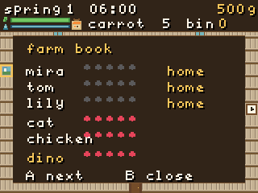 | 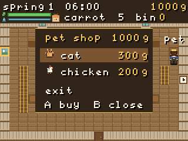 |
| 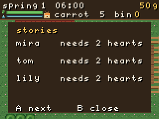 | 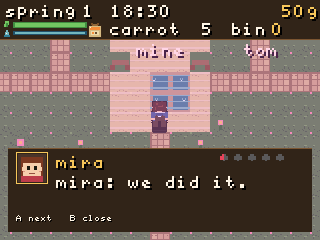 |

## 自己改

这不是一个只能玩的封闭固件。完整源码都在仓库里，可以自己继续改：

```bash
git clone <your-repo>
cd native
make deps
make -j4
make sim
make test
```

作物、NPC、场景、物品、故事和 UI 都在 `native/src/game.c`。
`docs/AI-HANDOFF.md` 里有完整架构、存档格式和修改配方。
改完重新生成 UF2，拷进掌机，就能继续玩自己的版本。

## 编译

### 依赖

- macOS 或 Linux
- `make`
- Python 3
- ARM GNU 工具链（例如 xPack `arm-none-eabi-gcc`）
- `libopencm3` 不提交；用 `make deps` 拉取固定版本 `v0.8.0`，第一次 `make` 会自动编译 `stm32f4` 静态库

默认工具链路径：

```text
toolchain/xpack-arm-none-eabi-gcc-15.2.1-1.1/bin
```

其他路径：

```bash
cd native
make TOOLCHAIN=/path/to/arm-none-eabi/bin
```

### 固件

```bash
cd native
make deps      # 拉取 libopencm3 v0.8.0
make -j4
```

如果 `third_party/libopencm3` 不存在，直接 `make` 也会自动拉取。

生成：

```text
native/build/app.uf2
```

### 模拟器

```bash
cd native
make sim
```

输出在 `native/sim/out/`，不会提交到仓库。

## 烧录

1. 按住 **Menu + B** 进入 bootloader
2. 电脑出现 `ARCADE-F4` U 盘
3. 把 `native/build/app.uf2` 拷进去
4. 设备自动重启

macOS：

```bash
cp native/build/app.uf2 /Volumes/ARCADE-F4/
```

或：

```bash
cd native
make flash
```

存档在 Flash sector 7，和 App 区分离，普通升级不会清掉农场。

## 硬件

| | |
|---|---|
| 设备 | ELECFREAKS RETRO Arcade for Education |
| MCU | STM32F412RE，Cortex-M4F |
| 主频 | 96 MHz，带 16 MHz 安全回退 |
| RAM | 256 KB |
| Flash | 512 KB（448 KB App + 64 KB bootloader） |
| 屏幕 | ILI9341，320×240，8-bit 并口 / FSMC |
| 存档 | 内部 Flash sector 7（`0x08060000`） |
| 声音 | PA08 PWM + PC10 功放使能 |

## 目录

```text
docs/                 设计、烧录说明、截图
firmware/             早期硬件测试和备份
native/
  src/                game.c、main.c、save.c、font8.c
  sim/                主机模拟器和回归测试
  tools/              UF2 / PNG 工具
  third_party/        libopencm3
tools/                UF2 检查工具
```

## 存档

当前 **v6**：

- 农场、作物、金币、体力、水壶
- 房子、水壶等级、鱼竿、故事进度
- NPC 爱心、送礼
- 背包选中、鱼、鸡蛋、化石
- 宠物、好感、小恐龙、矿洞铜矿、生命
- 鱼竿/剑等级

旧 v1–v4 自动迁移。睡觉、Menu → save、升级、完成故事时自动保存。

## 已知限制

- 模拟器不是逐周期模拟，真机帧率可能不同
- 写 Flash 时会短暂卡顿

## 开发

游戏逻辑在 `native/src/game.c`，固件和主机模拟器共用同一份代码。硬件层在 `native/src/main.c`：FSMC 屏幕、按键、时钟、PWM 声音。

`make sim` 会跑：

- 存档/读档
- 农场循环
- 菜单/背包
- 房子/水壶升级
- 季节
- 海滩/钓鱼
- 宠物/小恐龙
- 故事线
- 矿洞
- 彩蛋

## 致谢

- 硬件：[ELECFREAKS](https://www.elecfreaks.com/)
- STM32 库：[libopencm3](https://github.com/libopencm3/libopencm3)
- 工具链：[xPack ARM GNU Toolchain](https://xpack.github.io/arm-none-eabi-gcc/)
- 游戏代码与程序化美术：Keith Xi

## 许可证

原创游戏代码和美术使用 **MIT License**，见 [LICENSE](LICENSE)。

`libopencm3` 仍遵循其 LGPL/GPL 许可证，见 `native/third_party/libopencm3/COPYING.*`。

---

English: [README.md](README.md)
